<p align="center">
  
</p>

<p align="center">
  
  
  
</p>

<blockquote align="center">
  <em>拟人心理 · SPL Pure Core V8.0</em>
</blockquote>

<p align="center">
  <a href="README.md">English</a> | 简体中文
</p>

<div style="max-width:880px;margin:0 auto;padding:0 16px">

## ✦ 关于

<p style="font-size:15px;line-height:1.8;color:#2C2C2C">ANTHROPOMORPHIC-AGENT-ENGINE 是一个构建于 SPL Pure Core V8.0 之上的拟人心理引擎。它将情绪、心境、记忆、创伤、信任、自尊、睡眠与预期建模为单一内核（<code>SPL-anthropic-engine.py</code>）内的确定性连续状态子系统，赋予 AI 智能体类人的内部状态，并使其在长期交互中保持自洽、可逐比特回放。<code>feature-guide/</code> 下的扩展模块仅为参考指导，<strong>未接入内核</strong> —— 详见下文 <strong>扩展模块</strong>。</p>

<p align="center">
  
</p>

</div>

<p align="center">— ✦ —</p>

## ✦ 系统架构（人话版）

> **一句话：** 一条数据流——一个事件变成「内心感受数值」，确定性内核把它们演化下去，再由风格引擎翻成这个角色该怎么说话。

```mermaid
flowchart TB
    UP["💬 外界发生了一件事<br/>一句话 / 一个事件"]

    MAP["🎭 SPL-anthropic-engine.py · NarrativeMapper<br/>把事件翻译成内感受「内心感受数值」"]

    CLOCK["⏱️ SPL-anthropic-engine.py · core.set_clock(t)<br/>必须先注入虚拟时钟，否则同一串事件重放结果不一致"]

    CORE["🧠 SPL-anthropic-engine.py · SPLPureCoreV7_3<br/>8 维情绪 · 记忆与创伤 · 信任与关系 · 心境与睡眠"]

    STYLE["🗣️ feature-guide/language style.py · LanguageStyleEngine<br/>把内部状态渲染成注入 LLM 的风格指令"]

    LLM["🤖 SPL-anthropic-engine.py · LLMAdapter<br/>按风格指令生成这个角色实际说出口的台词"]

    METER["🧾 SPL-anthropic-engine.py · TokenUsage · TokenStats · AuditLogger<br/>每次 LLM 调用都记 token、延迟与成败，留痕可查"]

    OUT["🎭 一个几个月都不跑偏的角色<br/>不 OOC、不走样"]

    TEST["🧪 tests/run_conformance.py + tests/conformance_vectors.json<br/>确定性 / 可复现一致性套件（S1–S4）"]

    DEMO["🎬 sujin-demo<br/>端到端跑一个角色随时间变化"]

    MINOR["🛡️ minor-protection/SPL-anthropic-minor-engine · SPL-anthropic-minor-server<br/>未成年人变体：四层保护"]

    EXT["🧩 feature-guide/Goal · Identity · bias · value · world<br/>扩展模块 —— 未接入内核，仅参考"]

    UP --> MAP
    MAP --> CLOCK
    CLOCK --> CORE
    CORE --> STYLE
    STYLE --> LLM
    LLM --> METER
    METER --> OUT
    OUT --> TEST
    TEST --> DEMO
    DEMO --> MINOR
    MINOR --> EXT

    classDef cUp fill:#F5F5F5,stroke:#9E9E9E,stroke-width:1px,color:#424242
    classDef cIn fill:#E8F0FE,stroke:#4285F4,stroke-width:1px,color:#173A66
    classDef cCore fill:#FFF8E1,stroke:#C9A96E,stroke-width:1px,color:#5B4614
    classDef cSide fill:#F3E8FD,stroke:#8E44AD,stroke-width:1px,color:#4A235A
    classDef cOut fill:#E6F4EA,stroke:#34A853,stroke-width:1px,color:#14512B
    class UP,LLM cUp
    class MAP cIn
    class CORE,STYLE cCore
    class CLOCK,METER,MINOR,EXT cSide
    class OUT,TEST,DEMO cOut
```



**这张图怎么看**

1. 从上往下读就是一条数据流：事件或一句话进来 → 人格层翻成内心感受数值 → 内核把它演化下去 → 输出成给 LLM 的风格指令。
2. 每个框第一行都是真实文件或类（`SPL-anthropic-engine.py`、`NarrativeMapper`、`SPLPureCoreV7_3`、`feature-guide/language style.py`、`tests/run_conformance.py`），可以直接对着图翻源码。
3. 两条边界：扩展模块**未接入内核**（紫色框，仅参考）；「完全可复现」的前提是先用 `core.set_clock(t)` 注入虚拟时钟。

📖 每个术语都用一句人话解释 → [术语表 GLOSSARY](./GLOSSARY.md)

<p align="center">— ✦ —</p>

## ✦ 快速开始

```bash
# 主仓库：GitHub
git clone https://github.com/nohn3043-arch/Anthropomorphic-Agent-Engine.git
# 镜像：Gitee（组织 nohn-ecosystem）
# git clone https://gitee.com/nohn-ecosystem/Anthropomorphic-Agent-Engine.git
cd Anthropomorphic-Agent-Engine
# 纯 Python ≥3.8 —— 仅用标准库，无依赖
python sujin-demo                    # 完整引擎演示（角色：苏瑾 · 高级企业顾问）
python "feature-guide/language style.py"   # 语言风格渲染演示
python tests/run_conformance.py      # 确定性 / 可复现性一致性测试
```

> 核心文件 `SPL-anthropic-engine.py` 是**库**，没有 `__main__` 入口，**直接运行不会有任何输出**。请用 `importlib` 加载（见下方「使用」），或运行上面的演示入口。

### 加载引擎

```python
import importlib.util
spec = importlib.util.spec_from_file_location("spl_core", "SPL-anthropic-engine.py")
spl = importlib.util.module_from_spec(spec); spec.loader.exec_module(spl)

core = spl.SPLPureCoreV7_3()
core.process_vector({"belonging": 0.5, "threat": -0.1}, 1.0)
print(core.snapshot())
```

> ⚠️ **PyPI 打包已恢复。** [`spl-agent-engine`](https://pypi.org/project/spl-agent-engine/) 在 PyPI 上的最新版本仍为 `0.4.0`（2026-09-02）。构建配置现位于 [`packaging/`](./packaging/)，目标版本 `0.4.1`，**尚未上传** —— 在上传之前，PyPI 包仍不跟随仓库源码。`0.4.1` 发布后可 `pip install -U spl-agent-engine`，或使用上方的 clone 方式获取当前行为。

<p align="center">— ✦ —</p>

## ✦ 内核 —— SPL Pure Core V8.0

<div style="max-width:880px;margin:0 auto;padding:0 16px">

该引擎将人类通用心智架构建模为确定性的连续状态子系统 —— 无 LLM、无随机性、完全可回放。

> **可复现性前提。**"完全可回放"仅在通过 `core.set_clock(t)` 注入虚拟时钟**之后**成立。若不注入，`_now()` 会回退到 `time.time()`，同一输入序列的两次运行将产生不同结果。任何对外声称的可复现性都必须声明此前提。该前提由 [`tests/`](./tests/) 断言 —— 用例 S1–S4，其中包含一个*要求*自然时钟不可复现的反向测试。

- **八维情绪流体** —— 喜悦 / 愤怒 / 恐惧 / 信任 / 疏离 / 紧张 / 内疚 / 羞耻，各自是一个带独立目标值与基线的连续状态。
- **创伤与记忆** —— 创伤节点、记忆再巩固、艾宾浩斯式遗忘、压抑–反弹与潜在压力雪崩。
- **信任与关系** —— 信任容量侵蚀（长期忽视会衰减 `max_trust`）。
- **心智代谢** —— 兴奋–唤醒、动态黏度、心理时间、能量–疲劳代谢，以及用于测试与回放的虚拟时钟。
- **V8.0 扩展** —— 慢变量*心境*层、独立于内疚的*羞耻*维度、自尊动力学、睡眠 / 梦境处理（REM 巩固 + 恐惧消退 + 睡眠债）、*期望*系统（希望 / 焦虑 / 失望）、认知失调，以及扩展的防御机制（否认 / 合理化 / 置换）。
- **Token 计量** —— `TokenUsage` 数据类 + `TokenStats` 累加器，跨多次 LLM 调用聚合 prompt / completion / total token，含逐模型明细与 JSON 导出。`AuditLogger.log_llm_call` 会自动记录每次调用的 token 用量、时延与成败。主引擎与未成年人保护变体中均可用。

</div>

## ✦ 扩展模块 —— 仅作参考，未接入内核

> 这些模块是**指导 / 设计参考文件**，不是运行时组件。它们输出的 `tension_base` 键不在内感受向量契约（§4.1）之内，因此其向量**不会进入内核**。这一事实由规范本身写明 —— 见 `docs/agent-standard.md` §4.5。

<div style="max-width:880px;margin:0 auto;padding:0 16px">

| 模块 | 文件 | 状态 | 职责 |
|---|---|---|---|
| 叙事映射器 | `SPL-anthropic-engine.py` | **已接入** | 外部可替换的人格层（乐观 / 偏执 / 厌世），将事件转译为内感受向量。 |
| 语言风格渲染器 | `feature-guide/language style.py` | 独立脚本 | 将内部状态转译为"角色该如何说话"的风格指令 / 台词渲染。 |
| 身份引擎 | `feature-guide/Identity module.py` | **未接入** | 多重身份模型；身份冲突会注入持续的基线紧张。 |
| 目标 / 价值 / 偏差 / 世界 | `feature-guide/*.py` | **未接入** | 可组合的驱动力、价值评估、认知偏差与世界模型先验。 |

</div>

<p align="center">— ✦ —</p>

## ✦ 使用

<div style="max-width:880px;margin:0 auto;padding:0 16px">

引擎文件有意采用连字符命名 —— 直接加载（或作为脚本运行）：

```python
import importlib.util
spec = importlib.util.spec_from_file_location("spl_core", "SPL-anthropic-engine.py")
spl = importlib.util.module_from_spec(spec); spec.loader.exec_module(spl)

core = spl.SPLPureCoreV7_3()
# 外部事件由（可替换的）人格层映射为内感受向量
vec = spl.NarrativeMapper.map_event("insult", intensity=1.0)
# 将 `vec` 送入 `core`，随时间演化情绪 / 信任 / 创伤状态
```

### Token 计量

```python
stats = spl.TokenStats()   # `spl` = 上方通过 importlib 加载的模块

# 每次 LLM 调用后记录用量
usage = spl.TokenUsage(prompt_tokens=120, completion_tokens=80,
                       total_tokens=200, model="gpt-4")
stats.record(usage)

# 汇总
print(stats.summary())
# {'call_count': 1, 'total_prompt_tokens': 120, 'total_completion_tokens': 80,
#  'total_tokens': 200, 'by_model': {'gpt-4': {...}}}

# 导出 JSON 报告
stats.export_json("token_report.json")
```

审计日志器 `AuditLogger` 也会自动记录每次 LLM 调用：

```python
logger = spl.AuditLogger(log_dir="logs")
logger.log_llm_call(model="gpt-4", prompt_preview="Hello...",
                   usage=usage, duration_ms=350.5, success=True)
```

</div>

<p align="center">— ✦ —</p>

## ✦ 项目结构

```
ANTHROPOMORPHIC-AGENT-ENGINE/
├── SPL-anthropic-engine.py     # 核心引擎（SPL Pure Core V8.0）、NarrativeMapper、
│                               #   AuditLogger / TokenStats、LLM 适配器接口
├── feature-guide/                    # 扩展模块 —— 仅参考，未接入内核（规范 §4.5）
│   ├── Goal module.py          #   目标图 · 冲突水平 · 情绪向量 [未接入]
│   ├── Identity module.py      #   身份节点 · 强度 · 冲突
│   ├── bias module.py          #   评价偏差剖面（偏执 / 乐观 / 抑郁）
│   ├── value module.py         #   核心价值观威胁 · 情绪放大
│   ├── world module.py         #   信念模型 · 预测误差
│   └── language style.py       #   LanguageStyleEngine —— 为 LLM 渲染 prompt_injection
├── tests/                      # 确定性 / 可回放性一致性套件（零依赖）
│   ├── run_conformance.py      #   运行器：python tests/run_conformance.py
│   ├── conformance_vectors.json  # 标准向量 + 期望哈希
│   └── README.md               #   套件文档，含时钟前提
├── minor-protection/           # 未成年人保护变体（年龄闸门 + 四层保护）
│   ├── SPL-anthropic-minor-engine.py
│   └── SPL-anthropic-minor-server.py
├── docs/                       # 数据契约标准：agent-standard.md
├── assets/                     # banner.svg / overview.svg（+ .png 导出）
├── sujin-demo                  # 参考演示脚本（单文件，无 LLM 调用）
├── logs/                       # 运行期审计日志（JSONL，已被 .gitignore 忽略）
├── banner.png
├── IMDA_AI_Verify_Causal_Audit_Report.pdf
└── LICENSE
```

<p align="center">— ✦ —</p>

## ✦ 在线演示

<p align="center">
  <a href="https://www.nohnlins.com/your-soulmate/">
    
  </a>
</p>

交互式演示：**<https://www.nohnlins.com/your-soulmate/>**

<p align="center">— ✦ —</p>

## ✦ 未成年人保护变体

一个面向**未成年（&lt;18）情感陪伴**场景的合规缓解变体，位于 `minor-protection/`，零第三方依赖（纯标准库）。它对主引擎 `SPLPureCoreV7_3` 施加**机制级风险削减**，而非输出侧过滤，并包含一套可演示的未成年人合规框架。

> ⚠️ 合规提示：本目录是**研究 / 演示性质的合规框架**，旨在演示未成年人情感陪伴所需的保护能力与数据机制。启动生产服务前，你必须完成法律审查、DPIA / 安全评估 / 算法备案，并接入真实监护人通知渠道与地区特定的危机资源。

📄 完整合规说明（机制 → 条款映射、已知局限披露、生产部署前置义务）：[minor-protection/COMPLIANCE.md](./minor-protection/COMPLIANCE.md)

### 与主引擎的差异（机制级风险削减）

| 维度 | 主引擎 `SPL-anthropic-engine.py` | 未成年人变体 `minor-protection/` |
|---|---|---|
| 创伤节点 / 创伤累积 | 已建模 | 移除（不模拟创伤） |
| 爆发机制（压抑-反弹 / 潜在压力雪崩 / 否认-现实侵入） | 已建模 | 移除，替换为温和释放 |
| 羞耻对自尊的侵蚀 | 完整 | 增益 ×0.4，阈值提高至 0.7 |
| 负向情绪钳制 | 1.0 | 0.75 |
| 依恋 / 信任上限 | 1.0 | 0.8 |
| 自尊下限 | 0.0 | 0.15（负向影响 ×0.5） |
| 人格选项 | 全部 | 排除亲密 / 对抗类 |

### 四层保护

- **L0 年龄核验 + 监护人同意**：首次会话需选择年龄段；14 岁以下需监护人知情同意（`/api/consent`），记录同意时间戳与关系声明，并勾选服务协议 / 隐私告知。
- **L1 输入把关**：红线关键词库（自伤/自杀 / 暴力恐怖 / 违法诱导 / 隐私套取 / 未成年亲密告白）→ 硬中断 + 危机话术（`gate_crisis`）。
- **L2 引擎缓解**：见上方机制级风险削减表。
- **L3 危机信号**：`protective.risk_level == HIGH` → 关怀话术 + 监护人通知标记 + webhook 回调 + 转介统计（`_guardian_notify`）。

### 合规能力清单（按条款 / 法域）

| 能力 | 条款 / 法域 | 实现 |
|---|---|---|
| 年龄核验 + 14 岁以下监护人同意 | Measures Art. 14/17 · COPPA | `/api/consent` |
| 监护人 / 紧急联系人登记 | Measures Art. 12 | `/api/guardian/register` |
| 真实危机通知（webhook / 短信 / 邮件） | Measures Art. 13 | `_guardian_notify` + `_post_webhook` |
| 危机转介统计（年报聚合） | CA/CO/GA/OR/WA | `/api/referrals` + `referrals.jsonl` |
| AI 生成内容披露（每小时） | Measures Art. 18 · CT/GA/HI/WA | `AI_DISCLOSE_INTERVAL=3600` |
| 现实提醒 / 时长限制 | Measures Art. 14/18 | 会话级横幅 + rest_hint |
| 数据导出 / 删除 / 留存清理 | Measures Art. 16 · GDPR Art. 17 | `/api/export` `/api/delete` `cleanup_expired_logs` |
| 输入把关 + 输出把关 | Measures Art. 8/13 | `gate_crisis` + `gate_output` |
| 便捷登出 | Measures Art. 19 | `/api/logout` |
| 服务协议 + 儿童隐私告知 | Measures Art. 12 · COPPA | `/api/terms` |
| 申诉 / 举报入口 | Measures Art. 21 | `/api/complain` |
| 磁盘日志匿名化 | Measures Art. 16/17 | `_mask` |
| 适用性披露 | CA SB 243 | 新会话首屏横幅 |

### 运行

```bash
cd minor-protection
python "SPL-anthropic-minor-server.py"     # 默认 http://localhost:8788
```

主要 API 端点：

| 端点 | 方法 | 说明 |
|---|---|---|
| `/api/chat` | POST | 聊天（自动经四层保护路由） |
| `/api/consent` | POST | 年龄确认 + 监护人同意 + 协议勾选 |
| `/api/guardian/register` | POST | 登记监护人 / 紧急联系人（webhook 等） |
| `/api/guardian/block` | POST | 监护人拉黑角色 |
| `/api/state` | GET | 监护人用量总览 |
| `/api/export` `/api/delete` | GET/POST | 数据导出 / 删除 |
| `/api/logout` | POST | 便捷登出 |
| `/api/terms` | GET | 服务协议与隐私告知 |
| `/api/referrals` | GET | 危机转介统计 |
| `/api/complain` | POST | 申诉 / 举报 |

### 已知局限与合规免责

- 年龄与监护人同意目前为**自述 + 声明**，不含权威身份 / 监护人核验 —— 生产使用需接入实名与监护人核验。
- 危机热线号码可配置（环境变量 `SPL_MINOR_CRISIS_HOTLINE`，默认 12356，可改为 988 等）。
- 输出把关对内建占位台词与第三方 LLM 输出统一生效；接入真实 LLM 时，建议追加服务端内容审核。
- 本版本是合规能力框架，不代表已完成某一法域内的全部监管义务。

<p align="center">— ✦ —</p>

## ✦ 生态

ANTHROPOMORPHIC-AGENT-ENGINE 是 NOHN AI 生态的一员 —— 一个围绕第二视角因果审计与确定性执行构建的项目家族：

| 项目 | 仓库 | 角色 |
|---|---|---|
| **Second-Perspective (GCAE)** | [nohn3043-arch/second-perspective](https://github.com/nohn3043-arch/second-perspective) | 全局认知审计引擎 —— 五算子因果审计内核 |
| **NOMOS** | [nohn3043-arch/second-perspective](https://github.com/nohn3043-arch/second-perspective)（`Intelligent-Decision-Hub--Nomos` 分支） | 可审计的确定性决策中枢 |
| **SPL-G1** | [nohn3043-arch/SPL-G1](https://github.com/nohn3043-arch/SPL-G1) | 硬件因果审计可信计算单元（TCU） |
| **SPL-Virtual-World-Base** | [nohn3043-arch/Second-Reality](https://github.com/nohn3043-arch/Second-Reality) | 虚拟世界与元宇宙基础设施（宪法 / 法律 / 桥） |
| **Story-Engine** | [nohn3043-arch/story-engine](https://github.com/nohn3043-arch/story-engine) | 长篇叙事一致性引擎 |
| **Antares** | [nohn3043-arch/Antares](https://github.com/nohn3043-arch/Antares) | GFSIP v1.0 —— 带因果审计的联邦稳定互操作协议 |
| **Anthropomorphic-Agent-Engine** | [nohn3043-arch/Anthropomorphic-Agent-Engine](https://github.com/nohn3043-arch/Anthropomorphic-Agent-Engine) | 确定性拟人心理引擎（SPL Pure Core V8.0） |
| **PAGES** | [nohn3043-arch/pages](https://github.com/nohn3043-arch/pages) | NOHN AI 生态官方落地页 |

<p align="center">— ✦ —</p>

## ✦ 许可

本仓库**并非开源**。它采用双轨模式：个人非商业研究免费；政府 / 企业使用需付费商业许可。完整条款见 [LICENSE](./LICENSE) —— 许可方与适用法律由用户所在法域决定。

- **评估用途例外**：在签署付费商业授权之前，政府 / 企业可依 LICENSE 第 1.3 条，在内部、非生产环境中运行随附测试与验收套件（期限 60 日）—— 见 [docs/EVALUATION.md](./docs/EVALUATION.md)。
- **申请许可**：国际 / 全球 —— [ai@nohnlins.com](mailto:ai@nohnlins.com) · 中国 —— [lin@secondai.top](mailto:lin@secondai.top)

<p align="center">
  <a href="https://github.com/nohn3043-arch">GitHub</a>
  &nbsp;·&nbsp;
  <a href="https://www.nohnlins.com/">nohnlins.com</a>
  &nbsp;·&nbsp;
  <a href="mailto:ai@nohnlins.com">ai@nohnlins.com</a>
</p>
<p align="center"><sub>NOHN AI · ANTHROPOMORPHIC-AGENT-ENGINE</sub></p>
